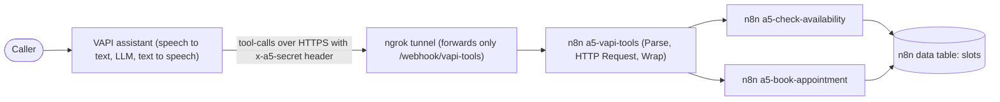

# A5: Voice Receptionist (VAPI + n8n)

**Goal:** After-hours call answering and appointment booking. Video-only showcase.

**Acceptance criteria (eval-driven):**
- 60-90 sec demo video
- README with architecture diagram

**Stack:** n8n 2.46.6 (Docker, pinned), VAPI. See ../../docs/ROADMAP.md

## Architecture

**Status:** in progress. Done: n8n in Docker, `check-availability` webhook (reads the n8n `slots` data table, seeded from `data/slots_seed.csv`; checked by `scripts/a5_smoke_webhook.py --expect`). Booking (`book-appointment` webhook, an Update row(s) filtered on status=available) is checked by `scripts/a5_smoke_booking.py`: validation, double booking, and one parallel-race run. That test consumes two slots, which are put back to status=available by the manual-trigger workflow `workflows/a5-reset-smoke-slots.json` (it resets status only; patient_name and phone keep the test values). VAPI-shaped tool-call messages are translated by the `a5-vapi-tools` adapter workflow (`workflows/a5-vapi-tools.json`) and checked by `scripts/a5_smoke_vapi_adapter.py` (8 checks, including rejection without the `x-a5-secret` header; no slot consumed; the messages follow VAPI docs, not yet a real VAPI call). The adapter webhook uses n8n Header Auth with a secret kept in `.env` (A5_VAPI_SECRET); the ngrok tunnel only forwards `/webhook/vapi-tools` (`ngrok-policy.yml`), every other path gets a 404 from ngrok. The VAPI assistant, two function tools and custom credential are configured in the VAPI dashboard (see `docs/vapi_assistant.md`) and one real VAPI web call (dashboard Talk, 2026-11-07) reached n8n through the tunnel: check_availability and book_appointment both got HTTP 200 with the x-a5-secret header accepted, and the booking for 2026-11-10 17:00 succeeded (checked in the VAPI call log, which is not committed because it contains the header value). Rough edges seen: the phone number arrived in pieces from speech-to-text, the assistant asked for the name twice, and it saved the name as "Smoke test" so the reset workflow, which matches "Smoke Test" exactly (case-sensitive), did not catch that row. After a successful booking n8n also posts a confirmation to a public ntfy.sh topic (phone masked; the booking smoke test produced exactly two messages for two bookings; no SMS to the caller, and the message also arrived during a real VAPI call). Four real test calls (happy path with a bad phone first, full day and out-of-range date, medical and cancel request, emergency) are logged in [docs/TEST_CALLS.md](docs/TEST_CALLS.md), including the speech-to-text mistakes seen. Not done yet: demo video, tunnel, test-calls log.

Setup, run and test steps, call flow and known limits: [docs/SETUP.md](docs/SETUP.md)
